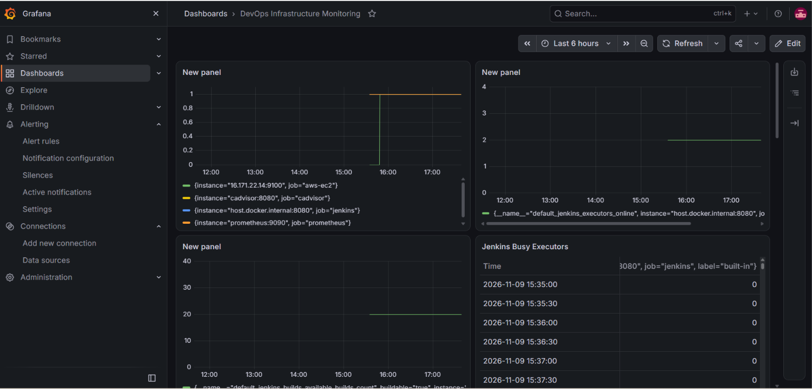

# DevOps Infrastructure Monitoring Project

## Overview
A real-time infrastructure monitoring system built using Prometheus, Grafana, Docker, and AWS EC2.

## Technologies Used
- Prometheus
- Grafana
- Docker
- Docker Compose
- cAdvisor
- Node Exporter
- Jenkins
- AWS EC2
- Ubuntu Linux

## Architecture
Jenkins + Docker Containers + AWS EC2
              |
        Exporters
              |
          Prometheus
              |
           Grafana
              |
        Email Alerts

## Features
- Jenkins monitoring
- Docker container CPU and memory monitoring
- AWS EC2 CPU, RAM, and disk monitoring
- Grafana dashboard
- CPU and RAM alert rules
- Gmail email notifications

## Prometheus Targets
- Prometheus
- Jenkins
- cAdvisor
- AWS EC2 Node Exporter

## Alert Configuration
- CPU usage above 80% for 5 minutes
- RAM usage above 85% for 5 minutes

## Deployment
Deployed using Docker Compose on Ubuntu Linux.

## Author
Devendra

## 🏗️ Project Architecture

```mermaid
flowchart TD
    A["AWS EC2 Instance"] --> B["Node Exporter"]
    C["Jenkins Server"] --> D["Jenkins Metrics"]
    E["Docker Containers"] --> F["cAdvisor"]
    B --> G["Prometheus"]
    D --> G
    F --> G
    G --> H["Grafana Dashboard"]
    H --> I["Email Alerts"]
## 📊 Grafana Dashboard


